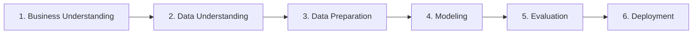
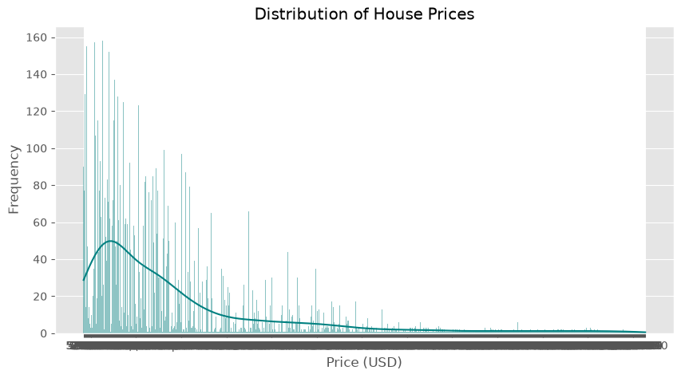
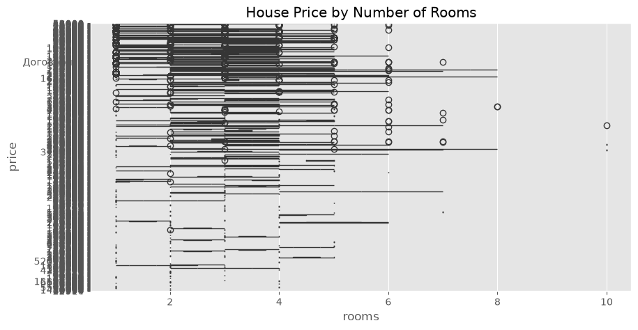
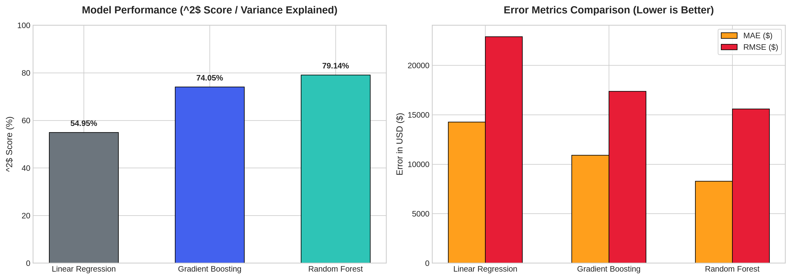
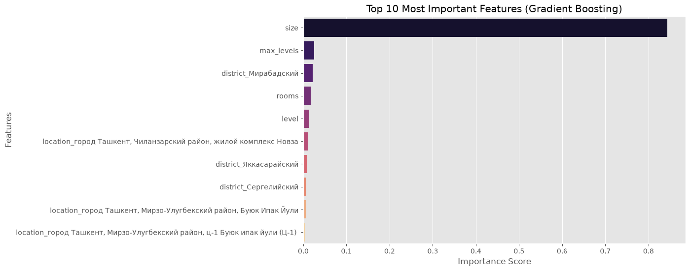

# 🏠 Tashkent Real Estate Price Prediction

[](https://www.python.org/)
[](https://opensource.org/licenses/MIT)
[](https://scikit-learn.org/)
[](https://en.wikipedia.org/wiki/Cross-industry_standard_process_for_data_mining)
[]()

> An end-to-end Machine Learning regression solution to predict apartment prices across Tashkent city, built following the industry-standard **CRISP-DM** methodology.

---

## 📑 Table of Contents
- [Project Overview](#-project-overview)
- [Methodology (CRISP-DM)](#-methodology-crisp-dm)
- [Dataset Architecture](#-dataset-architecture)
- [Exploratory Data Analysis (EDA)](#-exploratory-data-analysis-eda)
- [Data Preprocessing Pipeline](#-data-preprocessing-pipeline)
- [Models & Experiments](#-models--experiments)
- [Evaluation & Benchmark Comparison](#-evaluation--benchmark-comparison)
- [Key Insights & Feature Importance](#-key-insights--feature-importance)
- [Repository Structure](#-repository-structure)
- [Getting Started](#-getting-started)
- [Usage Guide](#-usage-guide)
  - [1. Running the Jupyter Notebook](#1-running-the-jupyter-notebook)
  - [2. Model Training via CLI](#2-model-training-via-cli)
  - [3. Price Prediction via CLI](#3-price-prediction-via-cli)
- [Future Roadmap](#-future-roadmap)
- [License & Acknowledgments](#-license--acknowledgments)

---

## 📌 Project Overview

Valuing residential real estate accurately is critical for property buyers, real estate agencies, financial institutions, and property investors. In rapidly growing markets like Tashkent, housing prices vary significantly depending on geography, building floor count, living area, and micro-locations.

This repository provides an automated data pipeline, exploratory analysis, and multiple regression models to estimate property listing prices in USD.

### Key Highlights:
- **Comprehensive Data Pipeline:** Automated cleaning of non-standard records, missing values handling, and 1%–99% price quantile anomaly filtering.
- **High-Dimensional Categorical Encoding:** One-Hot Encoding across Tashkent's districts and micro-districts.
- **Benchmarked Regressors:** Comparison across Linear Regression, Random Forest, and Gradient Boosting.
- **Production-Ready Structure:** Clean separation of modular code (`src/`), notebooks, visual assets (`assets/images/`), datasets, and pretrained model serialization.

---

## ⚙️ Methodology (CRISP-DM)

The project adheres to the **Cross-Industry Standard Process for Data Mining (CRISP-DM)**:



1. **Business Understanding:** Quantify apartment market values accurately to reduce subjective pricing bias and manual valuation delays.
2. **Data Understanding:** Analyze 7,500+ apartment listings, inspect distribution skewness, identify outlier ranges and missingness.
3. **Data Preparation:** Clean string columns, impute missing values, filter extreme price outliers, and one-hot encode categorical features.
4. **Modeling:** Train baseline linear model alongside ensemble bagging (Random Forest) and boosting (Gradient Boosting) architectures.
5. **Evaluation:** Measure performance using MAE, RMSE, and $R^2$ scores on an unseen holdout test set (20%).
6. **Deployment:** Serialize trained models and weights (`.pkl`) with a standalone CLI prediction tool.

---

## 📊 Dataset Architecture

The dataset includes listings across various districts of Tashkent:

| Column | Type | Description |
| :--- | :--- | :--- |
| `location` | `string` | Granular address or micro-district (e.g. *Chilanzar 2-quarter*, *Yunusabad 8*) |
| `district` | `string` | Administrative district of Tashkent (e.g., *Чиланзарский*, *Юнусабадский*) |
| `rooms` | `integer` | Total number of rooms in the apartment |
| `size` | `float` | Apartment total living area in square meters ($m^2$) |
| `level` | `integer` | The floor level on which the apartment is situated |
| `max_levels`| `integer` | Total floors in the residential building |
| `price` | `float` | **Target Variable:** Listing price in USD ($) |

The raw dataset is stored in [`data/housing_data_08-02-2021.csv`](data/housing_data_08-02-2021.csv).

---

## 🔍 Exploratory Data Analysis (EDA)

Understanding the raw distribution of real estate prices and room dynamics in Tashkent is essential prior to model training:

### 1. Price Distribution & Right-Skewness
The apartment prices exhibit a notable right-skewed distribution, with the majority clustered around $30,000–$80,000 USD, alongside a long tail of luxury properties exceeding $250,000 USD.



### 2. Price Distribution by Number of Rooms
A clear positive trend exists between the number of rooms and price, though multi-room apartments display higher variance due to location premiums (e.g., city center vs. peripheral suburbs).



---

## 🧹 Data Preprocessing Pipeline

1. **Data Sanitization:**
   - Columns `size` and `price` contained non-numeric entries (e.g., *"Договорная"* / Negotiable). These were coerced to numeric `NaN`.
   - Missing `size` entries were imputed using the column mean.
   - Rows without a valid `price` were dropped.
2. **Outlier Mitigation:**
   - Extreme price anomalies were filtered using the 1st percentile ($Q_{0.01}$) and 99th percentile ($Q_{0.99}$) thresholds:
   $$\text{Filtered Data} = \{ x \mid Q_{0.01} \le \text{price}(x) \le Q_{0.99} \}$$
3. **Encoding & Dimensionality Expansion:**
   - `location` and `district` columns were converted into binary features via **One-Hot Encoding** (`drop_first=True`), preventing artificial ordinal bias and capturing geographic micro-premiums.
4. **Train / Test Partitioning:**
   - 80% Training Set (`5,857` samples)
   - 20% Holdout Testing Set (`1,465` samples)

---

## 🤖 Models & Experiments

Three distinct regression algorithms were implemented and evaluated:

1. **Ordinary Least Squares (Linear Regression):** Serves as an interpretable linear baseline.
2. **Random Forest Regressor:** An ensemble bagging method utilizing 100 decision trees to capture non-linear feature interactions and resist overfitting.
3. **Gradient Boosting Regressor:** Sequential boosting trees (`n_estimators=100`, `learning_rate=0.1`) that iteratively minimize residual errors.

---

## 📈 Evaluation & Benchmark Comparison

The models were evaluated on the independent test dataset using:
- **Mean Absolute Error (MAE):** Average magnitude of prediction errors in USD.
- **Root Mean Squared Error (RMSE):** Penalizes larger deviation outliers.
- **Coefficient of Determination ($R^2$):** Proportion of variance explained by the model.

### 📊 Benchmark Visual Comparison


### 🏆 Benchmark Summary Table

| Model | MAE (USD) | RMSE (USD) | $R^2$ Score | Performance Rank |
| :--- | :---: | :---: | :---: | :---: |
| **Random Forest Regressor** | **$8,284.10** | **$15,590.87** | **0.7914 (79.14%)** | 🥇 **Best Performer** |
| **Gradient Boosting Regressor** | $10,924.41 | $17,388.99 | 0.7405 (74.05%) | 🥈 Runner Up |
| **Linear Regression** | $14,272.59 | $22,910.68 | 0.5495 (54.95%) | 🥉 Baseline |

> **Conclusion:** **Random Forest** achieved the highest accuracy with an **$R^2$ score of ~79.1%** and the lowest Mean Absolute Error (**~$8,284 USD**), explaining almost 80% of total price variation on unseen data.

---

## 🎯 Key Insights & Feature Importance

Feature importance scores from the tree-based models highlight the primary drivers of apartment values in Tashkent:



1. **Apartment Size ($m^2$):** The single most dominant factor determining property valuation.
2. **District Location:** High-demand central areas (such as *Yakkasaray*, *Mirzo-Ulugbek*, and *Shaykhantakhur*) command significantly higher square-meter premiums compared to peripheral suburbs.
3. **Floor Dynamics:** Mid-level floors (floors 2–5 in mid-rise blocks) typically command price premiums over ground and top floors.

---

## 📂 Repository Structure

```text
Tashkent_House_Price_Prediction/
├── assets/
│   └── images/                             # Evaluation plots & visualizations
│       ├── model_comparison.png            # Model benchmark comparison plot
│       ├── feature_importance.png          # Top 10 feature importances plot
│       ├── price_distribution.png          # Histogram & KDE of house prices
│       └── price_by_rooms.png              # Boxplot of prices grouped by rooms
├── data/
│   ├── README.md                           # Dataset documentation
│   └── housing_data_08-02-2021.csv         # Raw real estate dataset
├── models/
│   └── .gitkeep                            # Directory for saved model weights (.pkl)
├── src/
│   ├── __init__.py                         # Python package initializer
│   ├── preprocessing.py                    # Cleaning & feature transformation module
│   ├── train.py                            # Model training and evaluation script
│   └── predict.py                          # CLI inference / prediction script
├── Tashkent-Real-Estate-Price-Predictor.ipynb # Primary interactive CRISP-DM notebook
├── requirements.txt                        # Project dependencies
├── .gitignore                              # Git exclusion patterns
├── LICENSE                                 # MIT License
└── README.md                               # Project documentation
```

---

## 🚀 Getting Started

### Prerequisites
- Python 3.9, 3.10, 3.11, or 3.12
- `git` version control

### 1. Clone the Repository
```bash
git clone https://github.com/your-username/Tashkent_House_Price_Prediction.git
cd Tashkent_House_Price_Prediction
```

### 2. Create and Activate a Virtual Environment
```bash
# On Linux / macOS:
python3 -m venv venv
source venv/bin/activate

# On Windows:
python -m venv venv
venv\Scripts\activate
```

### 3. Install Dependencies
```bash
pip install --upgrade pip
pip install -r requirements.txt
```

---

## 💻 Usage Guide

### 1. Running the Jupyter Notebook
To step through the exploratory data analysis, visual distributions, and interactive CRISP-DM modeling:
```bash
jupyter notebook Tashkent-Real-Estate-Price-Predictor.ipynb
```

### 2. Model Training via CLI
You can train and evaluate all models and persist the weights to `models/` with one command:
```bash
python -m src.train
```
**Sample Output:**
```text
Step 1: Loading raw data...
Step 2: Cleaning and preprocessing...
Shape after cleaning & one-hot encoding: (7322, 1554)
Step 3: Splitting train and test sets (80/20)...
Step 4: Training candidate models...
--- Random Forest ---
  MAE:      $8,284.10
  RMSE:     $15,590.87
  R2 Score: 0.7914 (79.14% variance explained)
Models and feature list successfully saved to models/
```

### 3. Price Prediction via CLI
Once trained, estimate the price for any apartment by passing its parameters:
```bash
python -m src.predict --rooms 3 --size 75 --level 4 --max_levels 9 --district "Чиланзарский"
```
**Output:**
```text
==========================================
🏠 Tashkent House Price Prediction Result
==========================================
  Rooms:       3
  Size:        75.0 m²
  Floor:       4 / 9
  District:    Чиланзарский
------------------------------------------
  Estimated Price: $54,800.00 USD
==========================================
```

---

## 🔮 Future Roadmap

- [ ] **Interactive Web UI:** Deploy a user-friendly web interface using **Streamlit** or **Gradio**.
- [ ] **REST API:** Build a lightweight **FastAPI** microservice with input schema validation via Pydantic.
- [ ] **Geocoding & Map Visualizations:** Convert addresses to latitude/longitude coordinates to model distance to metro stations and central landmarks (e.g. Amir Timur Square).
- [ ] **Advanced Algorithms:** Benchmark against modern gradient boosting libraries (**LightGBM**, **XGBoost**, and **CatBoost**) with Bayesian hyperparameter tuning via **Optuna**.
- [ ] **Docker Containerization:** Add Dockerfile and docker-compose configurations for seamless deployment.

---

## 📄 License & Acknowledgments

- **License:** This project is licensed under the [MIT License](LICENSE).
- **Data Source:** Special thanks to [Anvar Narzullaev](https://github.com/anvarnarz) (Mohirdev / Praktikum) for curating and providing the Tashkent real estate dataset.
