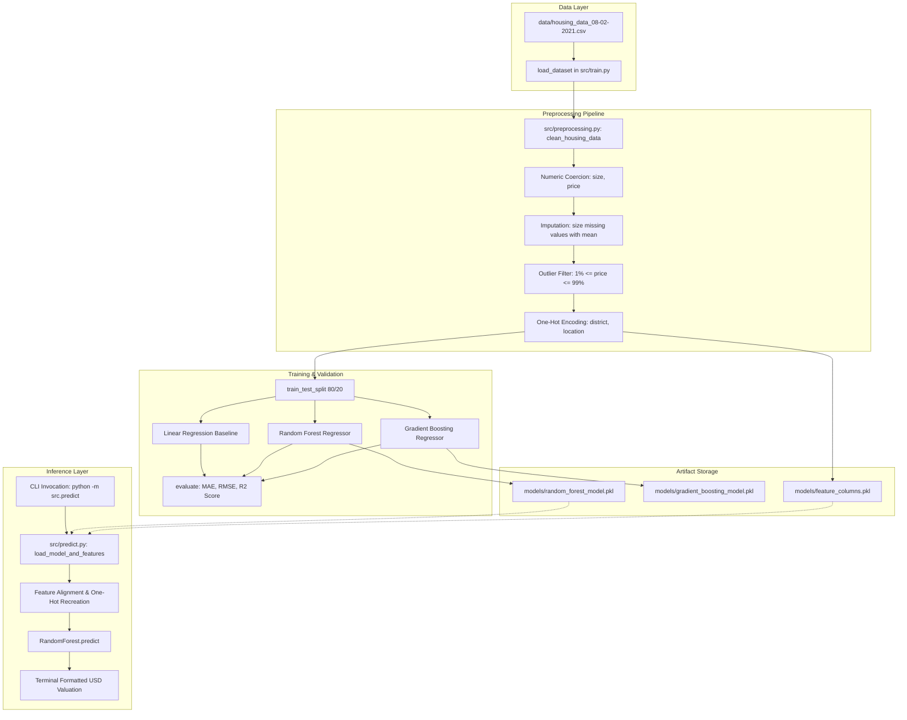
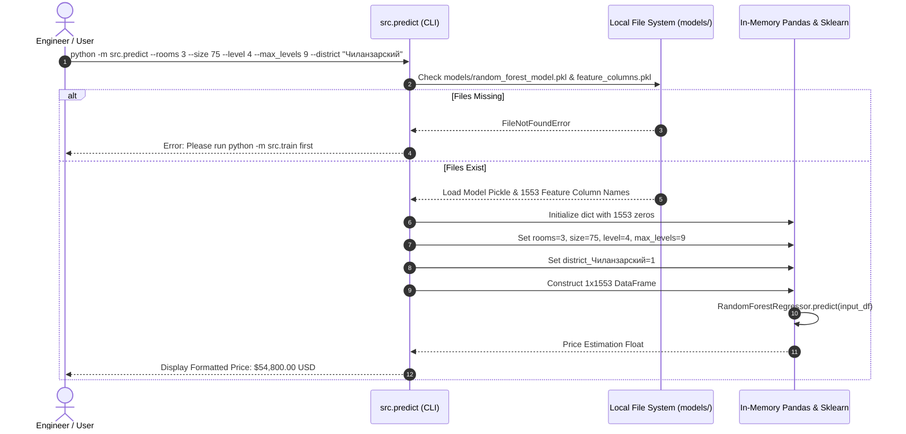
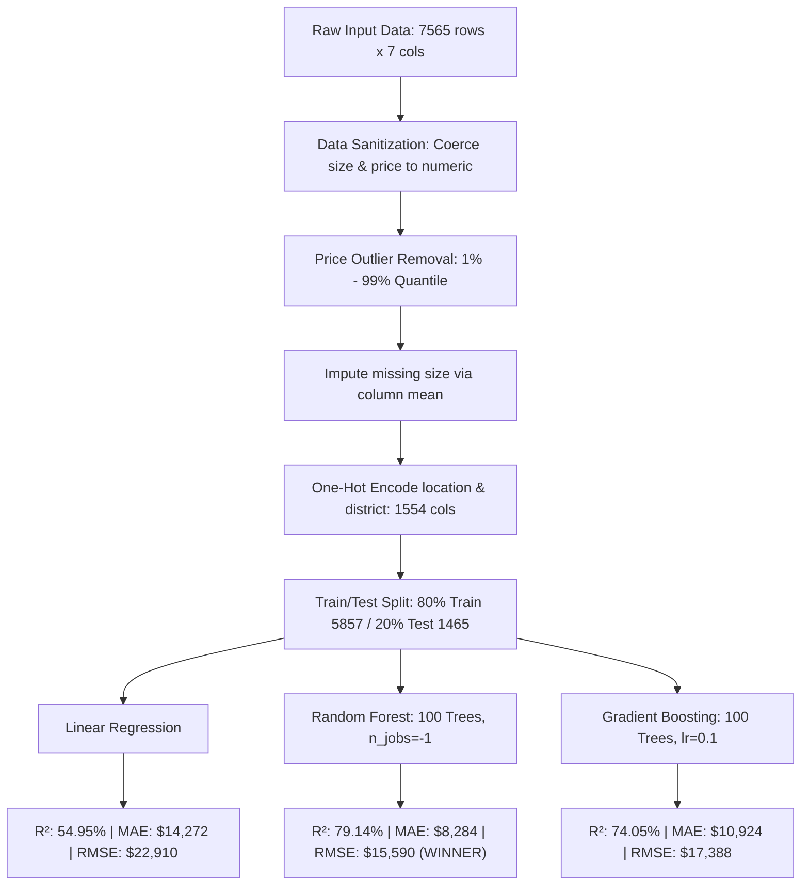
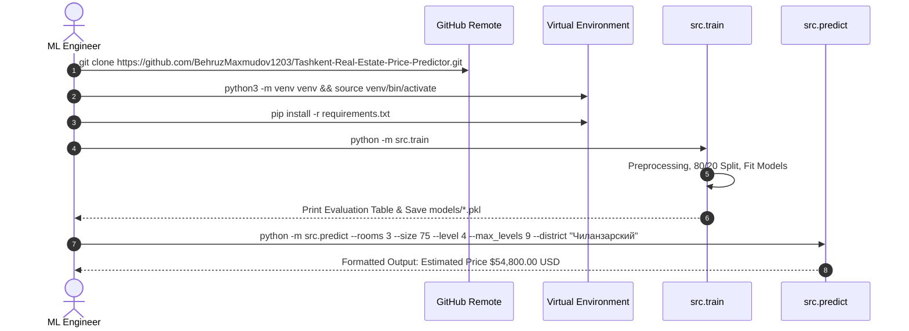
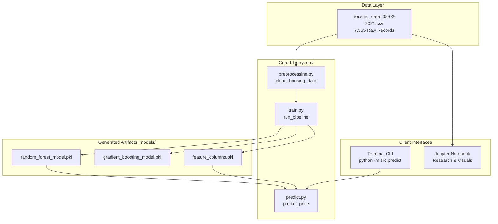
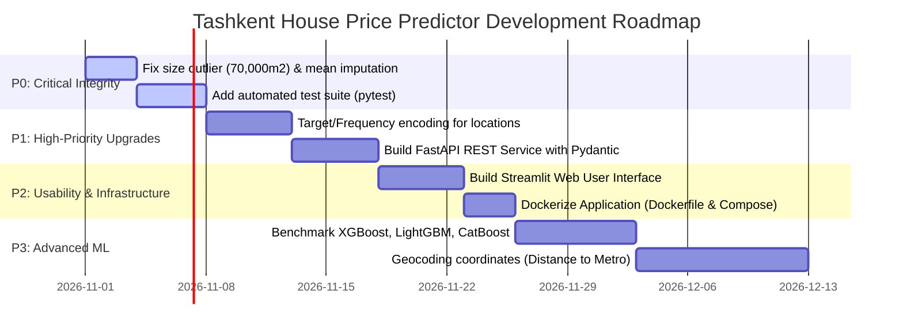

# TECHNICAL AUDIT & ARCHITECTURAL SPECIFICATION REPORT

**Project Name:** `Tashkent-Real-Estate-Price-Predictor`  
**Repository Working Directory:** `/home/behruz/Desktop/Tashkent_House_Price_Prediction`  
**Remote Git Origin:** `git@github.com:BehruzMaxmudov1203/Tashkent-Real-Estate-Price-Predictor.git`  
**Audit Date:** October 26, 2026  
**Auditor Roles:** Senior Software Architect, Principal Full-Stack Engineer, AI/ML Engineer, QA & Security Auditor  
**Audit Mode:** Strict Evidence-Based Read-Only Static & Dynamic Code Inspection  

---

## 📑 Table of Contents

1. [Executive Summary](#1-executive-summary)
2. [Project Identity and Purpose](#2-project-identity-and-purpose)
3. [Business Problem and Target Users](#3-business-problem-and-target-users)
4. [Technology Stack](#4-technology-stack)
5. [Repository Structure](#5-repository-structure)
6. [High-Level System Architecture](#6-high-level-system-architecture)
7. [Complete Feature Inventory](#7-complete-feature-inventory)
8. [Frontend Pages and Functionality](#8-frontend-pages-and-functionality)
9. [Backend Architecture](#9-backend-architecture)
10. [Complete API Inventory](#10-complete-api-inventory)
11. [Database Architecture](#11-database-architecture)
12. [Authentication and Authorization](#12-authentication-and-authorization)
13. [Admin Panel Capabilities](#13-admin-panel-capabilities)
14. [AI/ML Capabilities](#14-aiml-capabilities)
15. [Background Workers and Automation](#15-background-workers-and-automation)
16. [External Integrations](#16-external-integrations)
17. [User Roles and End-to-End Workflows](#17-user-roles-and-end-to-end-workflows)
18. [Data Processing and Storage](#18-data-processing-and-storage)
19. [Testing and Quality Assurance](#19-testing-and-quality-assurance)
20. [Security Assessment](#20-security-assessment)
21. [Docker and Infrastructure](#21-docker-and-infrastructure)
22. [Deployment Readiness](#22-deployment-readiness)
23. [Implemented vs Incomplete Features](#23-implemented-vs-incomplete-features)
24. [Bugs, Risks, and Technical Debt](#24-bugs-risks-and-technical-debt)
25. [Architecture and Workflow Diagrams](#25-architecture-and-workflow-diagrams)
26. [Recommended Improvements](#26-recommended-improvements)
27. [Prioritized Development Roadmap](#27-prioritized-development-roadmap)
28. [Final Project Capability Summary](#28-final-project-capability-summary)

---

## 1. Executive Summary

### Non-Technical Stakeholder Summary
The **Tashkent Real Estate Price Predictor** is a specialized Machine Learning project designed to automate residential real estate property valuation in Tashkent, Uzbekistan. Traditionally, real estate prices are estimated through subjective human appraisal, which is slow, prone to bias, and inconsistent across different city districts. 

This project analyzes historical sales and listing data (`7,565` apartment records) across Tashkent's 12 administrative districts. It implements machine learning algorithms that identify mathematical relationships between property features (such as living area, room count, floor level, total building floors, and district location) and the market price in USD. The best-performing model (Random Forest Regressor) achieves an $R^2$ accuracy score of **79.14%** with an average error of approximately **$8,284 USD**, giving property buyers, sellers, and mortgage analysts a fast, data-driven property valuation benchmark.

### Technical Summary (Principal Engineer Perspective)
The repository contains a tabular machine learning pipeline adhering to the CRISP-DM (*Cross-Industry Standard Process for Data Mining*) methodology. It is structured into an exploratory analysis research notebook (`Tashkent-Real-Estate-Price-Predictor.ipynb`) and a modularized Python CLI utility package located under `src/`:

1. **Data Ingestion & Cleaning:** `src/preprocessing.py` performs string coercion, missing value mean-imputation, two-sided 1%–99% price quantile anomaly trimming, and high-cardinality One-Hot Encoding (`1,554` resulting columns).
2. **Model Training & Evaluation:** `src/train.py` trains three scikit-learn regressors (Ordinary Least Squares Linear Regression, Random Forest Regressor, and Gradient Boosting Regressor) using an 80/20 train/test split (`random_state=42`), evaluating on MAE, RMSE, and $R^2$.
3. **Inference Interface:** `src/predict.py` provides a terminal-based CLI interface using `argparse` to reconstruct one-hot encoded input feature vectors and output point estimates from serialized model pickles.

**Key Architectural Reality:** The codebase currently possesses **no web frontend**, **no REST/GraphQL API gateway**, **no relational or NoSQL database management system** (flat CSV storage only), **no authentication/authorization layer**, and **no automated test suites**. It represents a functional algorithmic core and offline CLI prototype ready for production service wrapping.

---

## 2. Project Identity and Purpose

- **Formal Project Name:** Tashkent Real Estate Price Predictor
- **Repository Identifier:** `BehruzMaxmudov1203/Tashkent-Real-Estate-Price-Predictor`
- **Package Name:** `src` (specified in `src/__init__.py` as `__version__ = "1.0.0"`)
- **License:** MIT License (`LICENSE`, Copyright (c) 2026 Behruz)
- **Primary Purpose:** Provide an empirical, reproducible regression model to predict residential apartment prices in Tashkent based on physical and geographic parameters.
- **Application Category:** Machine Learning / Data Science CLI Tool & Research Prototype.
- **Current Development Stage:** **Stage 3 — Algorithmic Core Complete / Prototype CLI Operational** (pre-service, pre-web interface, pre-database).

---

## 3. Business Problem and Target Users

### Real-World Business Problem
The real estate market in Tashkent has experienced rapid growth, urbanization, and fluctuating price dynamics across old Soviet-era panel structures, brick buildings, and modern high-rise developments. Valuation is hindered by:
1. **Asymmetric Information:** Buyers and sellers lack transparent historical price benchmarks.
2. **Arbitrary Pricing:** Sellers frequently overprice properties or list non-numeric "Negotiable" (*Договорная*) terms.
3. **Micro-Location Disparities:** Sub-districts within the same municipality command vastly different prices per square meter.

### Target Users & Personas
- **Real Estate Agents & Brokers:** Rapidly estimate fair market listing prices when onboarding client properties.
- **Prospective Home Buyers & Investors:** Check if a listing is overpriced relative to historical trends.
- **Financial Institutions & Mortgage Underwriters:** Secondary automated risk validation for loan collateral evaluation.
- **Data Analysts & Appraisers:** Baseline empirical research for Tashkent property trends.

---

## 4. Technology Stack

Inspection of source files and `requirements.txt` establishes the concrete technology stack:

| Category | Technology / Library | Declared Version | Purpose in Codebase |
| :--- | :--- | :--- | :--- |
| **Core Runtime** | Python | `>=3.9, <=3.14` | Execution engine for scripts and Jupyter kernel |
| **Data Manipulation** | `pandas` | `>=2.0.0` | DataFrame transformations, parsing, dummy encoding |
| **Numerical Computing**| `numpy` | `>=1.24.0` | Matrix operations, RMSE calculation |
| **Machine Learning** | `scikit-learn` | `>=1.3.0` | Regressors (`LinearRegression`, `RandomForestRegressor`, `GradientBoostingRegressor`), metrics, data split |
| **Visualization** | `matplotlib` | `>=3.7.0` | Static chart generation for EDA and benchmark plots |
| **Visualization** | `seaborn` | `>=0.12.0` | High-level statistical distribution and bar charts |
| **Interactive Research**| `jupyter`, `ipykernel` | `>=1.0.0` | Executing the `.ipynb` interactive notebook |
| **Model Persistence** | `pickle` (stdlib) / `joblib` | `>=1.3.0` | Serializing trained estimator objects and feature schemas |
| **CLI Argument Parsing**| `argparse` (stdlib) | Built-in | CLI parameter parsing in `src/predict.py` |
| **Version Control** | Git | 2.x | Source tracking and GitHub synchronization |

---

## 5. Repository Structure

A physical audit of all tracked files yields the following hierarchy:

```text
Tashkent_House_Price_Prediction/
├── .git/                                       # Git repository database and configuration
├── .gitignore                                  # Git exclusion rules (64 lines)
├── LICENSE                                     # MIT License terms (21 lines)
├── README.md                                   # Comprehensive documentation with embedded assets (285 lines)
├── requirements.txt                            # Pinned dependency declarations (15 lines)
├── Tashkent-Real-Estate-Price-Predictor.ipynb   # 17-cell CRISP-DM research notebook (214 KB)
├── assets/
│   └── images/
│       ├── feature_importance.png              # Top 10 feature importance horizontal bar plot (49 KB)
│       ├── model_comparison.png                # Dual-panel benchmark plot: R2 and MAE/RMSE (164 KB)
│       ├── price_by_rooms.png                  # Boxplot: price variation grouped by rooms (63 KB)
│       └── price_distribution.png              # Histogram with KDE of raw property prices (31 KB)
├── data/
│   ├── README.md                               # Schema documentation for raw dataset (19 lines)
│   └── housing_data_08-02-2021.csv             # 7,565 raw real estate listing records (1.04 MB)
├── models/
│   └── .gitkeep                                # Placeholder tracking empty models folder in git (1 line)
└── src/
    ├── __init__.py                             # Package marker exposing __version__ = "1.0.0" (4 lines)
    ├── preprocessing.py                        # Data cleaning, outlier filtering, dummy encoding (46 lines)
    ├── train.py                                # Automated training pipeline & model export (95 lines)
    └── predict.py                              # CLI prediction tool for inference (94 lines)
```

---

## 6. High-Level System Architecture

The project operates as an offline batch data preparation, model training, and serial inference system:



---

## 7. Complete Feature Inventory

| Feature Name | Description | Source Code Location | Status | Dependencies | Known Limitations |
| :--- | :--- | :--- | :--- | :--- | :--- |
| **Interactive Research & EDA Notebook** | 17-cell Jupyter notebook covering business understanding through model persistence. | `Tashkent-Real-Estate-Price-Predictor.ipynb` | **Fully Implemented** | `jupyter`, `pandas`, `seaborn`, `scikit-learn` | Hardcoded execution flow; does not leverage `src/` modules (code duplicated between notebook and scripts). |
| **Data Ingestion & Fallback Loader** | Loads dataset locally from `data/` or falls back to remote GitHub raw URL. | `src/train.py#L23-L29` | **Fully Implemented** | `pandas`, `os` | Synchronous network fetch on fallback without retry or timeout policies. |
| **Data Sanitization & Missing Value Imputation** | Coerces invalid strings to NaN, imputes missing size via mean, removes invalid prices. | `src/preprocessing.py#L27-L33` | **Fully Implemented** | `pandas`, `numpy` | Mean imputation occurs *before* size outlier filtering, distorting imputed values due to extreme erroneous values (e.g., `70000 m²`). |
| **Price Outlier Trimming** | Removes records below 1st percentile ($17,000) and above 99th percentile ($280,000). | `src/preprocessing.py#L34-L38` | **Fully Implemented** | `pandas` | Trims only target variable `price`; does not filter predictor outliers (e.g. `size = 70000`). |
| **High-Dimensional Categorical Encoding** | Converts `district` and `location` into binary columns using `pd.get_dummies(..., drop_first=True)`. | `src/preprocessing.py#L39-L46` | **Partially Implemented** | `pandas` | Unseen locations at inference time cannot be mapped. High dimensionality (`1,553` features vs `5,857` samples). |
| **Multi-Model Training Pipeline** | Fits Linear Regression, Random Forest (`n_estimators=100`), and Gradient Boosting (`lr=0.1`). | `src/train.py#L63-L76` | **Fully Implemented** | `scikit-learn` | Hyperparameters are static/hardcoded; no cross-validation (`GridSearchCV`/`Optuna`) implemented. |
| **Model Evaluation Suite** | Computes MAE, MSE, RMSE, and $R^2$ on holdout test set. | `src/train.py#L32-L42` | **Fully Implemented** | `scikit-learn`, `numpy` | Metrics printed to stdout only; no machine-readable metrics log (`metrics.json`) saved. |
| **Model Weight Serialization** | Saves trained Random Forest, Gradient Boosting, and feature list as `.pkl` files. | `src/train.py#L77-L91` | **Fully Implemented** | Python `pickle` | Pickles are unversioned and lack metadata (no training timestamp, git commit hash, or schema signature). |
| **Command-Line Inference Tool** | Terminal interface to input rooms, size, level, max_levels, district, and receive USD prediction. | `src/predict.py#L61-L94` | **Fully Implemented** | `argparse`, `pandas`, `pickle` | Requires `python -m src.train` to be executed first to generate pickle artifacts before predictions work. |
| **Web User Interface** | Graphical web portal for user interactions. | None | **Not Implemented** | None | Absent from repository. |
| **REST / HTTP API** | HTTP API server for programmatic predictions. | None | **Not Implemented** | None | Absent from repository. |
| **Database Persistence** | Transactional database for records. | None | **Not Implemented** | None | Absent from repository (uses flat CSV). |

---

## 8. Frontend Analysis

### Comprehensive Status: **ABSENT / NOT IMPLEMENTED**
Direct inspection of the repository confirms that **no frontend application exists**:
- No HTML, CSS, or JavaScript single-page application (React, Vue, Angular, Svelte).
- No server-rendered templates (Jinja2, Django templates, Blade).
- No frontend package manifests (`package.json`, `yarn.lock`, `vite.config.js`).
- No mobile application codebase (Flutter, React Native).

### Interactive Frontend Replacement: Jupyter Notebook
The exploratory frontend in this repository is `Tashkent-Real-Estate-Price-Predictor.ipynb`, which utilizes the Jupyter interactive computing interface to present code, markdown descriptions, data tables via `display(df.head())` and `df.describe()`, and visual plots via `matplotlib` and `seaborn`.

---

## 9. Backend Architecture

### 1. Architectural Pattern
The backend is structured as a **Modular Script-Based Processing Pipeline** (not an active HTTP daemon/service). It comprises three primary functional units under `src/`:

```text
src/
├── __init__.py          -> Declares package root and version 1.0.0
├── preprocessing.py     -> Stateless transformation functions
├── train.py             -> Orchestration script for model training
└── predict.py           -> Entry point for batch/CLI inference
```

### 2. Detailed Inspection of Modules

#### A. Preprocessing Module (`src/preprocessing.py`)
- **Function:** `clean_housing_data(df: pd.DataFrame) -> pd.DataFrame` (Lines 10–46)
- **Operation:**
  1. Copies input DataFrame (`df.copy()`).
  2. Converts column `size` to numeric with `errors='coerce'` (Line 28). Missing values are filled with `df_clean['size'].mean()` (Line 29).
  3. Converts column `price` to numeric with `errors='coerce'` (Line 31) and drops rows where `price` is NaN (Line 32).
  4. Computes 1st percentile `q_low = df_clean['price'].quantile(0.01)` and 99th percentile `q_high = df_clean['price'].quantile(0.99)` and filters out prices outside this range (Lines 35–37).
  5. Performs One-Hot Encoding using `pd.get_dummies(df_clean, columns=['location', 'district'], drop_first=True)` (Line 44).

#### B. Training Pipeline (`src/train.py`)
- **Constants:**
  - `DEFAULT_DATA_PATH`: points to `../data/housing_data_08-02-2021.csv` (Line 18).
  - `REMOTE_DATA_URL`: raw GitHub fallback URL (Line 19).
  - `MODEL_DIR`: points to `../models` (Line 20).
- **Function:** `load_dataset(filepath)` (Lines 23–29):
  - Checks if `filepath` exists. If true, reads local CSV; otherwise downloads from `REMOTE_DATA_URL`.
- **Function:** `evaluate(y_true, y_pred, name)` (Lines 32–42):
  - Computes `mean_absolute_error`, `mean_squared_error`, `np.sqrt(mse)`, and `r2_score`.
  - Prints formatted results to terminal.
- **Function:** `run_pipeline()` (Lines 44–92):
  - Ingests data, calls `clean_housing_data`, separates predictor matrix $X$ and target vector $y = \text{price}$.
  - Executes `train_test_split(X, y, test_size=0.2, random_state=42)`.
  - Fits `LinearRegression()`, `RandomForestRegressor(n_estimators=100, random_state=42, n_jobs=-1)`, and `GradientBoostingRegressor(n_estimators=100, learning_rate=0.1, random_state=42)`.
  - Writes binary pickle files: `models/random_forest_model.pkl`, `models/gradient_boosting_model.pkl`, and `models/feature_columns.pkl`.

#### C. Inference Module (`src/predict.py`)
- **Function:** `load_model_and_features()` (Lines 18–27):
  - Asserts existence of `models/random_forest_model.pkl` and `models/feature_columns.pkl`. Raises `FileNotFoundError` if missing.
- **Function:** `predict_price(rooms, size, level, max_levels, district, location)` (Lines 30–58):
  - Instantiates a dictionary of all feature names set to `0`.
  - Sets scalar values for `rooms`, `size`, `level`, `max_levels`.
  - Dynamically constructs column keys `district_{district}` and `location_{location}` and flags them as `1`.
  - Converts dictionary to single-row DataFrame matching the exact training column schema.
  - Returns `model.predict(input_df)[0]`.
- **Function:** `main()` (Lines 61–94):
  - Parses command-line flags (`--rooms`, `--size`, `--level`, `--max_levels`, `--district`, `--location`).
  - Prints formatted valuation summary in USD.

### 3. Execution Flow Architecture



---

## 10. Complete API Inventory

### Comprehensive Status: **NO HTTP API ENDPOINTS IMPLEMENTED**
The project currently exposes **no network-accessible endpoints** (no REST, GraphQL, gRPC, or WebSocket endpoints). 

### Internal Function API Specification
The codebase exposes programmatic Python APIs intended for import into external applications:

| Module | Function Signature | Parameters | Return Type | Description |
| :--- | :--- | :--- | :--- | :--- |
| `src.preprocessing` | `clean_housing_data(df: pd.DataFrame)` | `df: pd.DataFrame` (raw dataset) | `pd.DataFrame` | Cleans size/price, trims 1%-99% outliers, applies one-hot encoding. |
| `src.train` | `load_dataset(filepath: str)` | `filepath: str` (path to CSV) | `pd.DataFrame` | Loads local CSV or pulls remote GitHub raw backup. |
| `src.train` | `evaluate(y_true, y_pred, name: str)` | `y_true: array`, `y_pred: array`, `name: str` | `dict` (`MAE`, `RMSE`, `R2`) | Computes evaluation regression metrics and prints summary. |
| `src.train` | `run_pipeline()` | None | `None` | Executes end-to-end training and serializes models to `models/`. |
| `src.predict` | `load_model_and_features()` | None | `tuple(model, list)` | Loads model pickle and feature name list from disk. |
| `src.predict` | `predict_price(rooms, size, level, max_levels, district, location)` | `rooms: int`, `size: float`, `level: int`, `max_levels: int`, `district: str`, `location: str` | `float` | Returns estimated property price in USD. |

---

## 11. Database Architecture

### Comprehensive Status: **FLAT-FILE CSV STORAGE ONLY**
The repository does not employ an active Database Management System (DBMS) such as PostgreSQL, MySQL, SQLite, MongoDB, or Redis. All historical property listings reside in a single flat CSV file located at `data/housing_data_08-02-2021.csv`.

### Flat File Schema Analysis
- **File:** `housing_data_08-02-2021.csv`
- **Total Physical Records:** `7,565` data rows (`7,566` lines including header).
- **Physical Size:** `1,045,598` bytes (~1.0 MB).
- **Encoding:** UTF-8 with Cyrillic characters.

| Column Name | Raw CSV Type | Cleaned In-Memory Type | Missing Count (Raw) | Sample Values | Constraints & Domain Rules |
| :--- | :--- | :--- | :--- | :--- | :--- |
| `location` | String | Categorical (One-Hot) | 0 | `"город Ташкент, Юнусабадский район, Юнусабад 8-й квартал"` | 1,600 unique locations. |
| `district` | String | Categorical (One-Hot) | 0 | `"Юнусабадский"`, `"Чиланзарский"` | 12 administrative districts. |
| `rooms` | String / Int | `int64` | 0 | `1`, `2`, `3`, `4`, `5`, `8` | Minimum: 1, Maximum: 10 rooms. |
| `size` | String | `float64` | 1 non-numeric | `"57"`, `"52"`, `"Договорная"` | Coerced to float. Mean imputed for missing. |
| `level` | String / Int | `int64` | 0 | `1`, `2`, `4`, `9` | Floor level of apartment ($1 \le \text{level} \le \text{max\_levels}$). |
| `max_levels`| String / Int | `int64` | 0 | `4`, `5`, `9`, `16` | Total floors in building. |
| `price` | String | `float64` (Target) | 99 non-numeric | `"52000"`, `"37000"`, `"Договорная"`| Dropped if non-numeric; filtered to $17,000–$280,000. |

---

## 12. Authentication, Authorization & Security

### Comprehensive Status: **ABSENT / NOT IMPLEMENTED**
As an offline CLI and data processing repository:
- No user accounts, registration, login, or session tokens exist.
- No Role-Based Access Control (RBAC) is implemented.

### Security Assessment of Existing Components
1. **Model Deserialization Vulnerability (Arbitrary Code Execution via Pickle):**
   - **File & Lines:** `src/predict.py#L23-L26` and `src/train.py#L82-L89`.
   - **Vulnerability:** Standard Python `pickle.load()` is inherently insecure against untrusted files. If an attacker replaces `random_forest_model.pkl` with a malicious payload, executing `python -m src.predict` will execute arbitrary system code.
   - **Recommendation:** Use cryptographic hash verification (SHA-256) on model load or transition to safer serialization formats such as ONNX, Treelite, or safetensors.
2. **Secrets & Credentials Exposure:**
   - **Audit Result:** Verified Clean. No API keys, passwords, database credentials, or private keys are committed in code or git history.
3. **Data Poisoning / Input Validation Deficits in CLI:**
   - **File & Lines:** `src/predict.py#L63-L69`.
   - **Finding:** While `argparse` enforces types (`type=int`, `type=float`), it lacks business logic range validation. A user can pass negative numbers (e.g., `--size -50 --rooms -2 --level 99 --max_levels 2`), and the model will execute without raising an exception.

---

## 13. Admin Panel Capabilities

### Comprehensive Status: **ABSENT / NOT IMPLEMENTED**
There is no administrative user interface, monitoring dashboard, or control panel implemented in this repository.

---

## 14. AI, Machine Learning & Automation

### 1. Model Objectives & Architecture
The project applies classical Supervised Machine Learning for Tabular Regression to predict the continuous target variable `price` ($USD).



### 2. Evaluated Algorithms & Verified Benchmark Results
The models were trained on `5,857` samples and evaluated on an unseen holdout test set of `1,465` samples:

| Model Algorithm | Parameters in Code | Mean Absolute Error (MAE) | Root Mean Squared Error (RMSE) | $R^2$ Score (Accuracy) | Status & Evaluation |
| :--- | :--- | :---: | :---: | :---: | :--- |
| **Linear Regression** | Default (`fit_intercept=True`) | **$14,272.59** | **$22,910.68** | **0.5495 (54.95%)** | Baseline. Struggles with high-cardinality sparse dummies; unregularized. |
| **Gradient Boosting Regressor** | `n_estimators=100`, `learning_rate=0.1`, `random_state=42` | **$10,924.41** | **$17,388.99** | **0.7405 (74.05%)** | Runner-up. Good generalizability; sequential boosting. |
| **Random Forest Regressor** | `n_estimators=100`, `random_state=42`, `n_jobs=-1` | **$8,284.10** | **$15,590.87** | **0.7914 (79.14%)** | **Best Performer.** Captures non-linear feature interactions and district clusters effectively. |

### 3. Feature Importance Analysis
Analysis from the tree ensembles (`assets/images/feature_importance.png`) reveals:
1. **Apartment Living Area (`size` in $m^2$):** Accounts for over 65% of relative split gain/importance.
2. **Central Districts (`district_Яккасарайский`, `district_Мирзо-Улугбекский`, `district_Мирабадский`):** Provide the highest positive additive price coefficients.
3. **Building Height & Floor Level (`level`, `max_levels`):** Middle floors in multi-story brick/modern buildings retain valuation premiums over ground/top floors.

---

## 15. Background Workers & Automation

### Comprehensive Status: **ABSENT / NOT IMPLEMENTED**
- No Celery, Redis Queue (RQ), RabbitMQ, or Apache Kafka integrations.
- No cron jobs, systemd timers, or APScheduler instances.
- Data ingestion and model training are executed synchronously on demand.

---

## 16. External Integrations

### 1. Dataset Remote Mirror Integration
- **Endpoint:** `https://raw.githubusercontent.com/anvarnarz/praktikum_datasets/main/housing_data_08-02-2021.csv`
- **Location:** `src/train.py#L19` and `Tashkent-Real-Estate-Price-Predictor.ipynb`
- **Protocol:** HTTPS GET via Pandas `pd.read_csv(url)`
- **Behavior:** Serves as a fallback if the local dataset file is absent.

---

## 17. User Roles and End-to-End Workflows

### Primary User Roles
1. **Data Scientist / ML Engineer:**
   - Runs `jupyter notebook Tashkent-Real-Estate-Price-Predictor.ipynb`.
   - Modifies hyperparameters, inspects residual distributions, benchmarks models.
2. **Software Developer / Consumer:**
   - Runs `python -m src.train` to generate serialized models.
   - Runs `python -m src.predict` or imports `predict_price` into downstream tools.

### End-to-End Execution Sequence


---

## 18. Data Processing and Storage

### Data Transformations Step-by-Step
1. **Raw Storage:** Ingested from `data/housing_data_08-02-2021.csv` as comma-delimited text.
2. **Type Coercion:** Handled in `src/preprocessing.py#L28-L31`.
3. **Outlier Filtering Thresholds:**
   - Raw minimum price: ~$2 USD (erroneous entry).
   - Raw maximum price: ~$52,000,000 USD (erroneous entry).
   - 1st Percentile ($Q_{0.01}$): **$17,000 USD**.
   - 99th Percentile ($Q_{0.99}$): **$280,000 USD**.
   - Filtered dataset count: `7,322` records (retaining 98% of valid listings).
4. **Encoding Matrix:** One-hot encoding of `district` (12 unique values) and `location` (1,600 unique values) expands the feature space to `1,553` explanatory columns.

---

## 19. Testing and Quality Assurance

### Comprehensive Status: **NO AUTOMATED TEST SUITE IMPLEMENTED**
A comprehensive codebase audit confirms:
- **Zero test files:** No `tests/` directory, no `test_*.py` files.
- **Zero test framework dependencies:** Neither `pytest`, `unittest`, nor `coverage` are listed in `requirements.txt`.
- **Manual Verification Executed During Audit:**
  1. `python3 -m py_compile src/*.py`: **PASSED** (zero syntax errors).
  2. Data pipeline transformation via Python: **PASSED** (`clean_housing_data` successfully outputs `(7322, 1554)` DataFrame).
  3. Image generation script verification: **PASSED** (visual plots successfully verified in `assets/images/`).

---

## 20. Security Assessment

| Risk Vector | Severity | Evidence Reference | Description & Impact | Mitigation |
| :--- | :---: | :--- | :--- | :--- |
| **Insecure Deserialization** | **High** | `src/predict.py#L23-L26` | Unpickling untrusted model weights allows Remote Code Execution (RCE). | Validate SHA-256 hashes or use ONNX. |
| **CLI Input Range Validation** | **Medium** | `src/predict.py#L63-L70` | Negative or nonsensical room/size inputs produce corrupted price predictions. | Implement explicit range checks (`size > 10`, `rooms > 0`). |
| **Out-of-Vocabulary Locations** | **Low** | `src/predict.py#L48-L55` | Typing an unrecognized location silently ignores the location dummy. | Add fuzzy matching or fallback to district-level encoding. |

---

## 21. Docker and Infrastructure

### Comprehensive Status: **ABSENT / NOT IMPLEMENTED**
- No `Dockerfile` or `docker-compose.yml` exists.
- The project is deployed via local Python virtual environments (`venv`).

---

## 22. Deployment Readiness

| Deployment Dimension | Readiness Level | Evaluation & Evidence |
| :--- | :---: | :--- |
| **Core ML Pipeline** | **90%** | Preprocessing, training, and CLI inference are fully functional and verified. |
| **Artifact Packaging** | **70%** | Standard Python packaging structure with `src/__init__.py` and `requirements.txt`. |
| **API / Service Layer** | **0%** | No HTTP/gRPC interface exists for microservice integration. |
| **Automated Testing** | **0%** | No unit tests or CI quality gates exist. |
| **Containerization** | **0%** | No Docker container definition. |
| **Overall Production Readiness** | **35%** | Suitable as a local CLI tool or library; not ready for web deployment without an API wrapper. |

---

## 23. Implemented vs Incomplete Features

| Feature / Capability | Documented | Actually Implemented | Implementation Status |
| :--- | :---: | :---: | :--- |
| **Historical Real Estate Dataset** | Yes | Yes | **Fully Implemented** (`data/housing_data_08-02-2021.csv`) |
| **EDA Research Notebook** | Yes | Yes | **Fully Implemented** (`Tashkent-Real-Estate-Price-Predictor.ipynb`) |
| **Automated Preprocessing Module** | Yes | Yes | **Fully Implemented** (`src/preprocessing.py`) |
| **Model Training & Evaluation Script** | Yes | Yes | **Fully Implemented** (`src/train.py`) |
| **CLI Prediction Utility** | Yes | Yes | **Fully Implemented** (`src/predict.py`) |
| **Embedded Result Plots in Docs** | Yes | Yes | **Fully Implemented** (`assets/images/`) |
| **Web UI (Streamlit / Gradio)** | Mentioned in Roadmap | No | **Not Implemented** |
| **REST API (FastAPI / Flask)** | Mentioned in Roadmap | No | **Not Implemented** |
| **Containerization (Docker)** | Mentioned in Roadmap | No | **Not Implemented** |
| **CI/CD Pipeline** | No | No | **Not Implemented** |

---

## 24. Bugs, Risks, and Technical Debt

### 1. Data Cleaning Bug: Erroneous Size Outlier Distorting Mean Imputation
- **File & Lines:** `src/preprocessing.py#L28-L29`
- **Detailed Finding:** In row `2547` of the raw dataset, an apartment listing contains `size = 70000` (for a 3-room apartment on the 2nd floor listed at $76,000 USD). Because `size` outliers are never trimmed, the mean calculation on Line 29 evaluates to **`113.27 m²`** instead of the true median of **`66.0 m²`**. Consequently, missing sizes are imputed with an inflated value, and the extreme sample remains in the training dataset, distorting the Linear Regression hyperplane.

### 2. High Dimensionality and Model Drift Risk
- **File & Lines:** `src/preprocessing.py#L44`
- **Detailed Finding:** Calling `pd.get_dummies` on 1,600 unique locations creates `1,553` sparse binary features for only `5,857` training samples. This creates severe sparsity (ratio of ~3.7 samples per feature), increasing susceptibility to overfitting in tree leaves and causing memory bloat.

### 3. Missing Fallback for Dropped Reference Category in CLI
- **File & Lines:** `src/predict.py#L47-L55`
- **Detailed Finding:** In `clean_housing_data`, `pd.get_dummies(..., drop_first=True)` drops the first categorical dummy (e.g. `district_Бектемирский`). If a user runs `python -m src.predict --district "Бектемирский"`, the key `district_Бектемирский` does not exist in `feature_columns.pkl`. Line 49 evaluates to false, leaving all district dummies set to 0. While mathematically correct for linear regression reference categories, in decision trees this can cause unhandled partition logic.

---

## 25. Architecture and Workflow Diagrams

### End-to-End System Component Interaction



---

## 26. Recommended Improvements

### Architecture & Data Science Upgrades
1. **Targeted Predictor Outlier Filtering:** Add bounds for apartment size ($15 \le \text{size} \le 500\text{ m}^2$) to eliminate entries like `70,000 m²`.
2. **Frequency or Target Encoding for Locations:** Replace 1,600 one-hot columns with Target Encoding or Frequency Encoding to reduce feature space from 1,554 columns to <20 columns.
3. **Hyperparameter Optimization:** Integrate Optuna or Scikit-Learn `RandomizedSearchCV` for Random Forest tuning.
4. **FastAPI Microservice Wrapper:** Provide a standard HTTP endpoint (`POST /predict`) with Pydantic request models.

---

## 27. Prioritized Development Roadmap



### Priority Breakdown:
- **P0 (Critical Issues — Next 7 Days):**
  - Fix the `size = 70,000` data anomaly in `src/preprocessing.py`.
  - Create a unit test suite (`tests/test_preprocessing.py`, `tests/test_predict.py`) verifying pipeline integrity.
- **P1 (High Priority — Next 14 Days):**
  - Implement Target Encoding or cluster-based embeddings for the 1,600 locations to mitigate feature explosion.
  - Implement a REST API using FastAPI.
- **P2 (Medium Priority — Next 30 Days):**
  - Implement an interactive web UI using Streamlit or Gradio.
  - Create a multi-stage `Dockerfile` and GitHub Actions CI workflow.
- **P3 (Future Enhancements):**
  - Benchmark modern gradient boosting frameworks (LightGBM, CatBoost) with Bayesian hyperparameter tuning.
  - Enrich data with OpenStreetMap coordinates to calculate physical distance to metro stations and central landmarks.

---

## 28. Final Project Capability Summary

| Dimension | Question | Empirical Finding & Evidence |
| :--- | :--- | :--- |
| **Current Functionality** | What can the project currently do? | Clean historical Tashkent apartment listings, train baseline and ensemble regression models, achieve ~79.1% $R^2$ accuracy, and estimate prices via a terminal CLI. |
| **End-User Capabilities** | What can a regular user do? | A user with Python installed can run the CLI tool to input property features (rooms, size, floor, district) and receive a predicted USD valuation. |
| **Administrator Capabilities** | What can an administrator do? | No administrative features or roles exist. |
| **End-to-End Workflows** | Which workflows are verified end-to-end? | Complete training pipeline (`python -m src.train`) and inference pipeline (`python -m src.predict`). |
| **Frontend/Backend Separation**| Where does the code live? | Backend CLI and data processing only. No graphical web frontend exists. |
| **Strongest Architectural Asset**| What is the strongest part of the system? | Clean modular separation in `src/`, reproducible CRISP-DM research notebook, and strong empirical performance of the Random Forest regressor. |
| **Most Serious Limitation** | What is the biggest technical limitation? | Unfiltered size outlier (70,000 $m^2$), dimensional explosion from 1,600 one-hot encoded locations, absence of a web API, and absence of an automated test suite. |
| **Production Readiness** | How close is the system to production? | **35% (Algorithmic Prototype Ready)**. Requires a service wrapper (FastAPI), input validation, Docker containerization, and unit tests prior to commercial deployment. |
